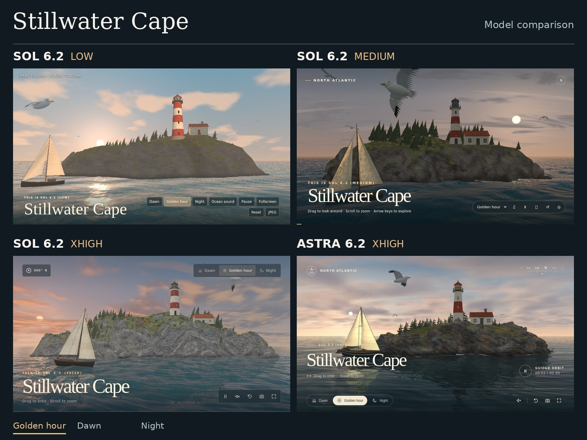

# Stillwater Cape

Four interactive takes on a coastal island. SOL 6.2 appears at LOW, MEDIUM and XHIGH effort. ASTRA 6.2 appears at XHIGH.

[Open the live comparison](https://maitham16.github.io/stillwater-cape-comparison/) · [Watch or download the 15-second film](https://maitham16.github.io/stillwater-cape-comparison/media/stillwater-cape.mp4)

## Explore the results

Switch between golden hour, dawn and night to compare matching moments. Select **Live grid** for four interactive scenes on the same page, or open an original at full size.

| Configuration | What to look for | Interactive result | Original HTML |
| --- | --- | --- | --- |
| SOL 6.2 · LOW | A broad, smooth cliff fills the view. At night, the pale moon sits just above the striped tower. | [Open scene](https://maitham16.github.io/stillwater-cape-comparison/scenes/sol-low.html) | [Source](scenes/sol-low.html) |
| SOL 6.2 · MEDIUM | The near sail fills the foreground and a gull passes close overhead, with pointed evergreens behind the lighthouse. | [Open scene](https://maitham16.github.io/stillwater-cape-comparison/scenes/sol-medium.html) | [Source](scenes/sol-medium.html) |
| SOL 6.2 · XHIGH | Gray seams run across the exposed cliff face. Watch how much of that rock texture stays visible at night. | [Open scene](https://maitham16.github.io/stillwater-cape-comparison/scenes/sol-xhigh.html) | [Source](scenes/sol-xhigh.html) |
| ASTRA 6.2 · XHIGH | Sunlight shines through the sail. At night, the lantern and cottage windows stand out against the dark island. | [Open scene](https://maitham16.github.io/stillwater-cape-comparison/scenes/astra-xhigh.html) | [Source](scenes/astra-xhigh.html) |

## Comparison method

Each result comes from one supplied, byte-for-byte copy of a standalone HTML scene. The layout uses the labels in the supplied folders. The original generation prompt and run history are pending, so this edition compares the delivered outputs visually.

Each recording uses a 960 × 540 viewport and the same animation clock. The capture starts at golden hour, selects dawn at 5 seconds and selects night at 10 seconds through each scene’s own controls. The cameras follow their native trajectories. Each preview still comes from the same frame number within a lighting pass. The silent 1440 × 1080 H.264 film keeps all four panels in fixed positions and repeats each of 15 captured frames per second to encode at 30 fps. [Capture runtime](media/capture.json)

## Reproduce the film

Run the **Render comparison** workflow from the repository’s **Actions** tab. Leave the optional run ID empty for a fresh capture, or supply a recent capture run ID to reassemble its frames. It captures each checked-in scene in Chromium, assembles the previews and MP4, and returns a downloadable artifact named `comparison-media`. [Workflow](.github/workflows/render.yml) · [Capture script](render/capture.mjs) · [Film composition](render/compose.py)

For local viewing, open `index.html` to browse the film, stills and original files. To enable the interactive grid, run `python3 -m http.server 8000` from the repository root and visit `http://localhost:8000`.

## Format references

The fixed grid follows visual coding comparisons where viewers can track a result in the same position throughout a clip. [Four-model example by @andronov04](https://x.com/andronov04/status/1904580391127707847) · [Two-model example by @flavioAd](https://x.com/flavioAd/status/1885449107436679394)
